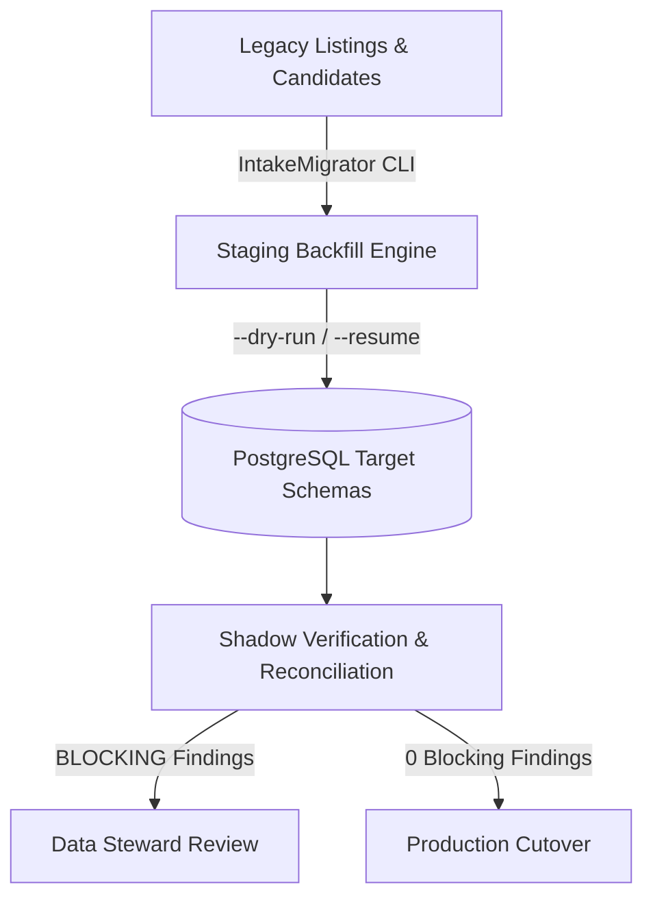

# Operational Runbook: Assisted Listing Intake Migration & Rollback

**Migration Ref**: `ODP-INTAKE-MIGRATION-001`
**Subsystem**: Assisted Listing Intake & Expansion
**Target Schema**: `intake`, `identity`, `expansion`, `workflow`, `audit`

---

## 1. Overview & Architecture

This runbook outlines the operational procedures for executing the staging backfill, data reconciliation, shadow identity comparison, rollback, and forward recovery for the Assisted Listing Intake subsystem migration (`ODP-INTAKE-MIGRATION-001`).

The migration transitions legacy listing ingestion and candidate site drafts into formal relational schemas with full lineage tracking, row-level security (RLS), and snapshot verification.



---

## 2. Pre-Migration Prerequisites & Verification

Before executing any migration in staging or production:

1. **Verify Database State & Tests**:
   ```bash
   UV_PYTHON=3.12 uv run --frozen pytest tests/ops/test_assisted_listing_intake_migration.py tests/ops/test_assisted_listing_intake_release.py -v
   UV_PYTHON=3.12 uv run --frozen ruff check product_ops/migrations/assisted_listing_intake tests/ops/test_assisted_listing_intake_migration.py
   ```

2. **Read the existing task in the canonical Supervisor checkout**:
   ```bash
   ./scripts/ai-status.sh show ODP-SYS-ACCEPT-261011
   ```
   This is a read-only task lookup. Keep the task's real owner/reviewer and use
   the existing Supervisor workflow for execution; a status check does not
   require declaring another worker's identity.

---

## 3. Staging Backfill Execution CLI

The backfill CLI supports dry-run validation, partition-level execution (by tenant, source, or month), and resuming interrupted backfills cleanly.
Database connection must be specified via `--db-dsn "$ODAY_DATABASE_URL"`, `--sqlite-path /path/to/db.sqlite`, or setting the `ODAY_DATABASE_URL` environment variable.

### 3.1 Dry Run Execution (Verification Only)

Run a dry run to validate mapping rules and check for potential reconciliation findings without committing changes to the database:

```bash
python3 -m product_ops.migrations.assisted_listing_intake.migrate \
  --action backfill \
  --tenant-id "00000000-0000-0000-0000-000000000001" \
  --db-dsn "$ODAY_DATABASE_URL" \
  --input-file /tmp/legacy_backfill_input.json \
  --dry-run
```

### 3.2 Partitioned Live Backfill

Backfill specific tenants, sources, or monthly partitions:

```bash
# Backfill Tenant A for July 2026 with resume enabled
python3 -m product_ops.migrations.assisted_listing_intake.migrate \
  --action backfill \
  --tenant-id "00000000-0000-0000-0000-000000000001" \
  --source-id "SRC-591" \
  --month "2026-07" \
  --db-dsn "$ODAY_DATABASE_URL" \
  --input-file /tmp/legacy_backfill_input.json \
  --resume
```

---

## 4. Reconciliation Findings & Shadow Verification

### Input scope and ownership

- The tenant selector supplies the explicit partition for legacy DTOs whose
  tenant field is absent or empty. It never overrides a recorded foreign,
  malformed or conflicting tenant. Unambiguously foreign rows are excluded;
  conflicting ownership is a blocking finding before it contributes to any
  address/source lookup. Nested Listing, Candidate and Address declarations
  participate in the same check.
- A Listing must record its own registered source. Missing source is not
  `SRC-591`, and an Intake's proposed match target does not make that Intake's
  source the Listing's origin. Candidate source can be read from the actual
  same-tenant Listing owner; nonempty `listing_source` and source aliases must
  agree with that owner.
- A valid out-of-source Listing and its source-less Candidate are both
  documented exclusions. The supplied owner's facts remain available for
  classification even though its business writes are excluded. Contradictory
  primary records assigning one Listing ID to different sources are rejected
  before business backfill; a selector cannot choose which origin is true.
- Intake and resources share the same source-exclusion rule. A proven
  out-of-source record's unrelated domain/history defects are excluded with
  that source. Tenant, source-alias and parent Listing identity conflicts
  remain blocking. An excluded resource never supplies business address facts.
  A same-tenant saved Listing's actual source is checked before exclusion,
  including for a source-less Candidate without month evidence; a conflicting
  supplied source cannot conceal the saved owner.
- Conflicting explicit Address IDs on duplicate primary Listing records are
  rejected. Missing IDs do not establish a contradiction, and this check does
  not infer revision order, merge historical addresses or deduplicate rows.
- Candidate Listing/address references must agree with their supplied owners,
  including any address ID recorded by the original Listing. A historical
  draft cannot silently replace that owner's address with a different ID.
- Resume verifies saved Listing source and Candidate/Promotion Listing
  bindings before counting an existing row in the selected partition. A
  conflict leaves existing business rows unchanged and records reconciliation;
  it is not a reason to relabel or overwrite them.
- Candidate's current Property can legitimately differ from the Listing's or
  Promotion's historical Property after an approved identity reassignment.
  Resume does not infer corruption or reverse that history from inequality.
  These checks do not attest Property/field/evidence parity.

Each successful non-dry-run backfill persists count/ID proof metrics and
findings to `workflow.reconciliation_findings`. Dry runs roll back their
writes. An aborted backfill rolls back metadata registration, findings and
business writes through the same transaction boundary.

### 4.1 Shadow Verification CLI Command

Run shadow comparison to prove data count parity against persisted proof metrics and check for blocking findings prior to cutover:

```bash
python3 -m product_ops.migrations.assisted_listing_intake.migrate \
  --action verify \
  --tenant-id "00000000-0000-0000-0000-000000000001" \
  --db-dsn "$ODAY_DATABASE_URL"
```

Expected output:
```json
{
  "tenant_id": "00000000-0000-0000-0000-000000000001",
  "open_findings": 0,
  "blocking_findings": 0,
  "shadow_comparison_success": true
}
```

> **Scope of this result**: `proof_scope` is
> `counts_and_ids_only_not_field_or_evidence_parity`. Zero blocking findings
> and a successful comparison complete this count/ID check; they do not
> authorize cutover. Field/evidence parity, the real shadow/canary window,
> tenant/source authority, rollback readiness and all release approvals remain
> governed by the [original migration rollout runbook](../operations/ODAY_PLUS_ASSISTED_LISTING_INTAKE_MIGRATION_ROLLOUT_RUNBOOK.md).
> Missing parser/snapshot provenance can leave warnings. Supplying an actual
> parser release does not establish missing snapshot evidence; do not invent
> provenance or treat a particular warning count as evidence completeness.

### 4.2 Handling Findings

- **BLOCKING Findings** (`STATE_MAPPING_CONFLICT`, `ORPHAN_REFERENCE`, `COUNT_MISMATCH`, `CHECKSUM_MISMATCH`):
  - **Action**: Must be resolved by a Data Steward or assigned a waived approval before cutover.
- **WARNING Findings** (including some missing provenance or duplicate-candidate findings):
  - **Action**: Follow the actual recorded severity and disposition. A missing
    or contradictory resource owner/source is blocking even when its finding
    type is `MISSING_EVIDENCE` or `INVALID_SCOPE`; do not downgrade it based on
    the type label. Preserve historical lineage and the original review flow.

---

## 5. Rollback & Forward Recovery Runbook

### 5.1 Trigger Conditions for Rollback

Execute rollback if any of the following occur during staging or cutover validation:
1. `shadow_comparison_success` returns `false` due to unresolvable data corruption or checksum mismatch.
2. High-severity data loss or tenant isolation leakage.
3. Live application error rate increases above SLA threshold during canary deployment.

### 5.2 Scoped Table Rollback Procedure

To roll back all data written by a migration without dropping relational schemas or destroying unrelated tables:

```bash
python3 -m product_ops.migrations.assisted_listing_intake.migrate \
  --action rollback \
  --tenant-id "00000000-0000-0000-0000-000000000001" \
  --migration-ref "ODP-INTAKE-MIGRATION-001" \
  --db-dsn "$ODAY_DATABASE_URL"
```

This safely deletes all records across `intake`, `identity`, `expansion`, and `workflow` written under `ODP-INTAKE-MIGRATION-001` for the specified tenant, leaving zero leftover state rows while preserving immutable WORM audit logs.

### 5.3 Forward Recovery Procedure

An invalid-input exception (for example contradictory primary Listing
owners) aborts the entire backfill transaction, including source/parser
registration and findings prepared before the error. Read the CLI error/log,
correct the input and rerun; that aborted attempt does not create a durable
finding or count proof. Previously committed rows and schema remain intact.
Do not interpret the absence of an aborted attempt's finding as a pass.

If blocking findings occur during backfill:

1. **Query Open Findings**:
   ```sql
   SELECT finding_id, source_kind, source_id, finding_type, severity, expected, actual
   FROM workflow.reconciliation_findings
   WHERE status = 'OPEN' AND severity = 'BLOCKING';
   ```
2. **Apply Remediation**:
   - Provide missing source evidence/revisions for legacy candidates.
   - Re-run backfill CLI with `--resume` enabled:
     ```bash
     python3 -m product_ops.migrations.assisted_listing_intake.migrate \
       --action backfill \
       --tenant-id "00000000-0000-0000-0000-000000000001" \
       --db-dsn "$ODAY_DATABASE_URL" \
       --input-file /tmp/legacy_backfill_input.json \
       --resume
     ```
